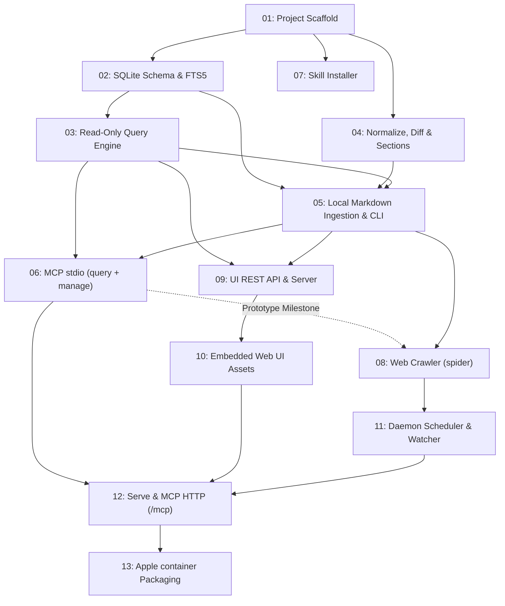

# Atomic Tasks — V1 (`citadel`)

> **Stage:** `Idea -> PRD -> TechSpec -> AgentRules -> [AtomicTasks (V1)] -> Prototype -> LLMCode`  
> **Specs:** [Docs/PRD.md](../../PRD.md) | [Docs/SPEC.md](../../SPEC.md) | [AGENTS.md](../../../AGENTS.md)

## Execution Strategy: Prototype-First Vertical Slice

- **Phase 1 — Prototype Milestone (Tasks 01–07):** Delivers a working end-to-end vertical slice (`local Markdown -> SQLite/FTS5 -> MCP stdio query+manage -> CLI -> skill install`) so you can ground Claude/Antigravity on local docs immediately.
- **Phase 2 — Full V1 (Tasks 08–13):** Layers `spider` web crawling, embedded local Web UI, background daemon/watcher + OS services, unified `citadel serve` (+ MCP Streamable HTTP `/mcp`), and Apple `container` packaging.

Each task is scoped to **1 focused LLM session**, follows **TDD red-first**, passes the full `AGENTS.md` check gate, and lands as **1 Conventional Commit**.

## Dependency DAG

## Task Checklist

### Phase 1 — Prototype Vertical Slice
- [x] [01-project-scaffold.md](./01-project-scaffold.md) — Cargo crate, `config.rs`, `stderr` tracing, `clap` CLI skeleton
- [x] [02-sqlite-schema-and-fts5.md](./02-sqlite-schema-and-fts5.md) — `schema.sql`, WAL pragmas, migrations, FTS5 triggers, views
- [x] [03-readonly-query-engine.md](./03-readonly-query-engine.md) — `db/readonly.rs` authorizer, timeout, row/byte caps, safety tests
- [x] [04-normalize-diff-and-sections.md](./04-normalize-diff-and-sections.md) — Frontmatter noise stripping, SHA-256, `similar` diffs, H1–H3 splitter
- [x] [05-local-markdown-ingestion.md](./05-local-markdown-ingestion.md) — Local `.md` folder ingestion, `stale` tracking, CLI `add`/`list`/`show`/`sync`/`rm`/`query`
- [x] [06-mcp-stdio-query-and-manage.md](./06-mcp-stdio-query-and-manage.md) — MCP `stdio` JSON-RPC 2.0, `query` + `manage` tools, SSRF/path guards
- [x] [07-skill-installer.md](./07-skill-installer.md) — Embedded router `SKILL.md` + `citadel skill install` (`.`, `--path`, `--global`)

### Phase 2 — Web Crawling, UI, Daemon, Serve & Apple `container`
- [x] [08-web-crawler-spider.md](./08-web-crawler-spider.md) — `spider` + `spider_transformations` crawler, `sitemap.xml`/`llms.txt`, optional `chrome` feature
- [x] [09-ui-rest-api-and-server.md](./09-ui-rest-api-and-server.md) — Axum localhost server, Origin guard, `/api/*` endpoints, `citadel ui`
- [x] [10-embedded-web-ui-assets.md](./10-embedded-web-ui-assets.md) — Offline `rust-embed` HTML/CSS/JS (Sources, Browser, Diffs/Health, SQL Explorer)
- [x] [11-daemon-scheduler-and-watcher.md](./11-daemon-scheduler-and-watcher.md) — PID lock, 60s scheduler, `notify` watcher, `launchd`/`systemd` service install
- [x] [12-serve-and-mcp-http.md](./12-serve-and-mcp-http.md) — Unified `citadel serve` (Daemon + UI + MCP Streamable HTTP `/mcp`)
- [x] [13-apple-container-packaging.md](./13-apple-container-packaging.md) — Multi-stage `Dockerfile`, `Makefile` for Apple `container` CLI, build verification
