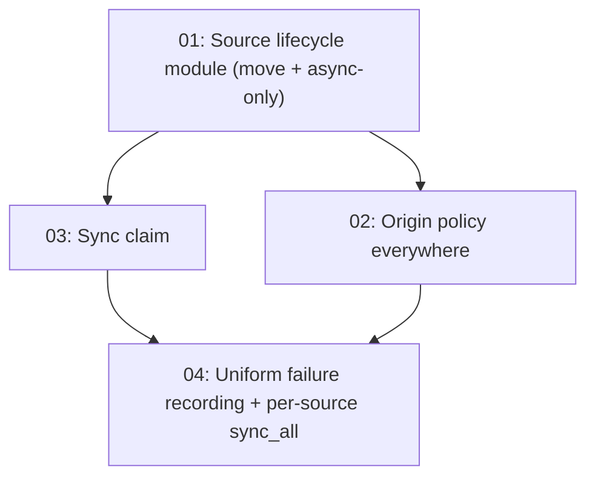

# Atomic Tasks — V2: Source lifecycle module (`web-vault`)

> **Stage:** `HumanAudit -> Telemetry -> iterate -> [AtomicTasks (V2)] -> LLMCode`
> **Context:** [CONTEXT.md](../../../CONTEXT.md) | [ADR-0001](../../adr/0001-database-sync-claim.md) | [Docs/SPEC.md](../../SPEC.md) | [AGENTS.md](../../../AGENTS.md)

## Why

An architecture review (2026-11-21) found the **Source lifecycle** smeared across `ingest/mod.rs`, `mcp/`, `ui/api.rs` and `daemon/`:

- **Private-origin check on one entry point only:** the SSRF check (`mcp/validate.rs`) runs only for MCP `manage add`. CLI and UI add Private origins unchecked.
- **Scheduler-only exclusion:** only the daemon scheduler prevents concurrent Syncs, using an in-process set. The UI, MCP, CLI and watcher can Sync the same Source at once.
- **Failures recorded on one path only:** pre-walk failures are recorded only by `sync_sources`. The watcher, add-then-sync, and web validation failures leave no trace on the Source.
- **Sync/async twins:** every operation exists twice (`add_source`/`add_source_async`, `sync_sources`/`sync_sources_async`), bridged by `run_async_blocking`.

V2 deepens this into one **Source lifecycle module** (`src/sources/`) that every caller crosses.

## Settled design

- **Interface:** async-only `SourceLifecycle` with `add`, `update`, `remove`, `sync`, `sync_all`, and `claim` → `ClaimedSync::run`. `sync` returns `SyncOutcome::{Synced, AlreadySyncing}`. `remove` returns `Removal::{Removed, AlreadySyncing}`. `sync_all` returns one result per Source.
- **Out of scope:** reads (`list_sources`, `show_source`) are left for a later read-model task.
- **Origin policy:** the Private-origin check runs inside the module, on `add` and at the start of every Sync. `WEB_VAULT_ALLOW_PRIVATE_ORIGINS=1` (exposed as a `VaultConfig` field) allows Private origins. The crawler's redirect check is kept. DNS-resolution checks are out of scope.
- **Sync claim ([ADR-0001](../../adr/0001-database-sync-claim.md)):**
  - Storage: a `sync_claims(source_id PK, pid, instance_token, claimed_at)` table.
  - Takeover: a claim may be taken over when its holder pid is dead, when the pid is ours but the per-process token is not (pid reuse, e.g. pid 1 in the container), or when the claim is older than a hard age limit.
  - Second caller: gets `AlreadySyncing`. The UI answers 409. The watcher queues one follow-up pass. The scheduler skips silently. `remove` takes the claim.
- **Scheduler:** keeps due-selection, the concurrency cap and jitter. Its in-flight set and its `status != 'syncing'` filter are removed; the claim is the only exclusion.
- **Failures:** every failed Sync records an error Sync run and sets `sources.status = 'error'`, whatever the entry point.
- **Tests:**
  - Exercised through the module's interface on a tempdir vault, with a loopback fixture and Private origins allowed.
  - The clock and pid-liveness checks sit behind a crate-private hook.

## Dependency DAG

| # | Task | Commit |
|---|------|--------|
| 01 | [Source lifecycle module](./01-source-lifecycle-module.md) | `refactor(sources): extract async-only source lifecycle module` |
| 02 | [Origin policy everywhere](./02-origin-policy.md) | `fix(sources): enforce private-origin policy on every entry point` |
| 03 | [Sync claim](./03-sync-claim.md) | `feat(sources): add database sync claim across processes` |
| 04 | [Failure recording & sync_all](./04-failure-recording-and-sync-all.md) | `fix(sources): record every sync failure and sync all sources independently` |
