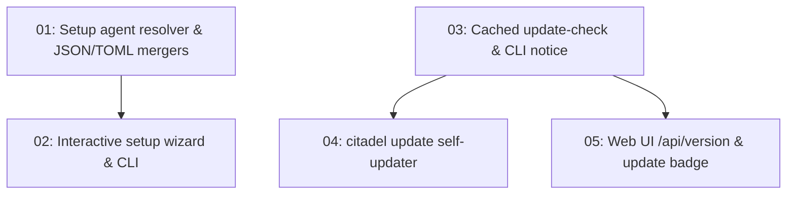

# Atomic Tasks — V3: Setup Wizard (`citadel setup`) & Self-Update (`citadel update`)

> **Stage:** `PRD -> SPEC -> [AtomicTasks (V3)] -> LLMCode`
> **Context:** [Docs/PRD.md](../../PRD.md) | [Docs/SPEC.md](../../SPEC.md) | [CONTEXT.md](../../../CONTEXT.md) | [AGENTS.md](../../../AGENTS.md)

## Why

V1/V2 delivered the core vault, MCP server, daemon, UI, and standalone `skill install`. Users still have to manually hand-edit per-agent MCP config files (`.mcp.json`, `~/.claude.json`, `~/.gemini/config/mcp_config.json`, `config.toml`) and manually check/reinstall new Citadel releases.

V3 closes both gaps:
- **Zero-friction onboarding (`citadel setup`):** Interactive terminal wizard (plus non-interactive flags) that installs the skill and safely merges MCP server settings—locally or globally—for **Claude Code**, **Antigravity (`agy`)**, and **Codex**.
- **Effortless self-maintenance (`citadel update` + automatic awareness):** Non-blocking 24h cached release checks surfaced subtly in interactive CLI sessions and the Web UI, paired with a single-command verified self-updater.

## Settled Design

- **Release distribution:** GitHub Releases prebuilt tarballs (`aarch64-apple-darwin`, `x86_64-apple-darwin`, `aarch64-unknown-linux-gnu`, `x86_64-unknown-linux-gnu`) + `checksums.sha256`.
- **`citadel update`:**
  - Native: download tarball + `checksums.sha256`, verify SHA-256, extract, atomically replace the running binary (rollback on failure), and restart running `citadel daemon` if active.
  - Container: detect container env (`/.dockerenv`, `/run/.containerenv`, `CITADEL_CONTAINER=1`) and print Apple `container` pull/recreate commands without mutating.
- **Automatic update awareness:** `<CITADEL_HOME>/update-check.json` (24h TTL); CLI reads synchronously (0 ms network cost) and spawns a non-blocking refresh when stale; prints a 1-line `stderr` notice only in interactive TTYs (never in `citadel mcp`, `--json`, non-TTY, or `CITADEL_NO_UPDATE_CHECK=1`); Web UI reads via `GET /api/version`.
- **`citadel setup`:**
  - Interactive `cliclack` wizard + non-interactive flags (`--agent`, `--scope`, `--transport`, `--url`, `--only`, `--force`, `--yes`).
  - Auto-detects `http://127.0.0.1:4317/mcp` reachability (defaults to `http` if reachable, else `stdio` `citadel mcp`).
  - Per-agent paths: Claude Code (`./.claude/skills/citadel`, `./.mcp.json` / `~/.claude.json`), Antigravity (`./.agents/skills/citadel`, local plugin `./.agents/plugins/citadel/` / `~/.gemini/config/mcp_config.json`), Codex (`./.agents/skills/citadel`, `./.codex/config.toml` / `~/.codex/config.toml`).
  - Safe merging via `serde_json` and `toml_edit` (preserves unrelated servers and TOML comments); summary preview before writing; interactive overwrite prompt / non-interactive `--force` guard.

## Dependency DAG

| # | Task | Commit |
|---|---|---|
| 01 | [Setup agent resolver & config mergers](./01-setup-agents-and-merge.md) | `feat(setup): add per-agent path resolver and safe JSON/TOML MCP mergers` |
| 02 | [Interactive setup wizard & CLI](./02-setup-cli-and-wizard.md) | `feat(cli): add interactive citadel setup wizard and non-interactive flags` |
| 03 | [Cached update-check & CLI notice](./03-update-check-cache.md) | `feat(update): add cached 24h update-check and non-blocking CLI notice` |
| 04 | [Self-update command](./04-self-update-command.md) | `feat(update): add citadel update with SHA-256 verification and atomic swap` |
| 05 | [Web UI version indicator](./05-ui-version-indicator.md) | `feat(ui): expose GET /api/version and show update badge in Web UI` |
