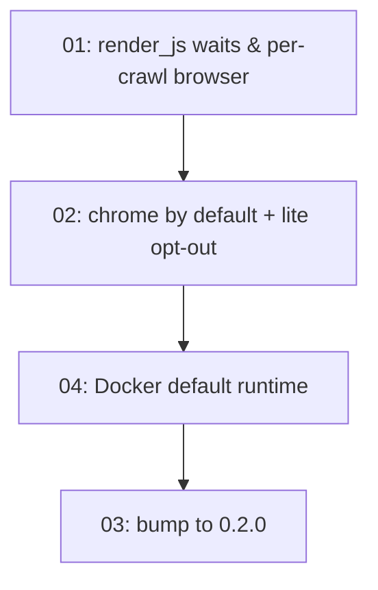

# Atomic Tasks — V4: JavaScript rendering by default (`chrome`) & v0.2.0

> **Stage:** `PRD -> SPEC -> [AtomicTasks (V4)] -> LLMCode`
> **Context:** [Docs/PRD.md](../../PRD.md) | [Docs/SPEC.md](../../SPEC.md) | [CONTEXT.md](../../../CONTEXT.md) | [AGENTS.md](../../../AGENTS.md)

## Why

Docs sites that build their navigation in the browser crawl as a single page. The Meraki Dashboard
API docs (`developer.cisco.com/meraki/api-v1/`) synced 2 pages: the server HTML has no sidebar
links, but after JavaScript runs the page holds 1,771 unique in-scope `<a href>` links. spider's
`chrome` mode reads links from the rendered page, but Citadel never used it in practice:

- `chrome` was opt-in (`default = []`), so release tarballs and `citadel update` never had it.
- `configure_website` set no wait, so even a `chrome` build read links before scripts ran.
- spider launches Chrome on one shared profile (`$TMPDIR/chromiumoxide-runner`), so two `render_js`
  Syncs at once failed, and a missing browser silently degraded to a static fetch.

## Settled Design

- **Per-crawl browser:** each `render_js` crawl launches its own headless Chrome with a private
  temporary profile (`src/ingest/browser.rs`) and hands spider its DevTools address
  (`with_chrome_connection`). `CHROME_URL`, when set, is used instead and checked up front.
  No browser → the Sync fails with one actionable error; Chrome only runs during `render_js` crawls.
- **Render wait:** `render_js` crawls wait for idle network and idle DOM (10 s cap per page) before
  reading links.
- **Default features:** `default = ["chrome"]`. Lite builds use `--no-default-features`, through
  `make install-lite` (native) and `make build-lite` (container).
- **Container runtime:** Docker by default; Apple `container` with `RUNTIME=container`
  (ADR-0003), after Apple `container`'s build cache filled the host disk.
- **Release & update:** release tarballs include `chrome`; `citadel update` warns a lite build that
  the update adds JS rendering. Version 0.2.0 is the first published release.

## Dependency DAG

| # | Task | Commit |
|---|---|---|
| 01 | [render_js waits & per-crawl browser](./01-render-js-browser.md) | `feat(ingest): render JS-built links with a per-crawl headless browser` |
| 02 | [chrome by default + lite opt-out](./02-chrome-default-lite-opt-out.md) | `feat(build): enable chrome by default with make install-lite/build-lite opt-out` |
| 04 | [Docker default runtime](./04-docker-default-runtime.md) | `feat(build): make Docker the default container runtime, keep Apple container optional` |
| 03 | [Bump to 0.2.0](./03-bump-0-2-0.md) | `chore(release): bump version to 0.2.0` |
