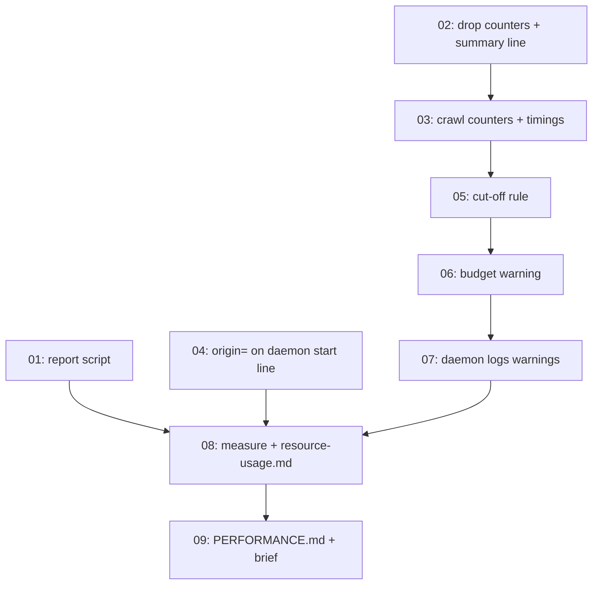

# Atomic Tasks — V5: Sync accounting & the cut-off fix

> **Stage:** `PRD -> SPEC -> [AtomicTasks (V5)] -> LLMCode`
> **Context:** [Docs/PRD.md](../../PRD.md) | [Docs/SPEC.md](../../SPEC.md) | [CONTEXT.md](../../../CONTEXT.md) | [AGENTS.md](../../../AGENTS.md)
> **Design (reviewed, EGM stages 5-9):** [sync-measurement design](../../egm/2026-11-24-sync-measurement-one-request-per-url-design.md) | [concepts_brief.md](../../egm/concepts_brief.md)

## Why

- **Pages wrongly marked stale.** The `dlthub` Sync of 2026-11-23 fetched about 1,000 pages but stored 756: 247 fetched pages were dropped, most of them redirected out of the Source. Citadel decides "ran out of budget" from the number of results (`web.rs:308`), so it treated the Sync as complete and marked 197 stored pages stale.
- **No numbers per step.** The daemon log shows one `fetch` line per request and nothing else. It does not say how long discovery, the first crawl, the later crawls, conversion and the write took, or why a fetched page was not stored.
- **Slow Syncs with unknown causes.** Nine logged Syncs show four patterns: paced by the 100 ms delay, a slow last part in `bench-uv`, dropped pages in `dlthub`, and a steady 3.1 requests per second in `meraki`. Before speeding anything up, each pattern must be measured.

## Settled Design

- **Accounting record:** a crate-private `WebSyncAccounting` travels through each web Sync. When the Sync ends, it logs one `web_sync_summary` line with the step durations, pages received, results, lost pages, six drop counters, later crawls started, `delay_ms`, `max_pages` and `cut_off`.
- **Cut-off rule:** a Sync is cut off when its first crawl used up `max_pages`, or when the distinct storable pages it collected reach `max_pages`, or when its results reach `max_pages`. A cut-off Sync marks no page stale, unless run with `--prune`.
- **Budget warning:** a cut-off Sync warns when at least 5 pages, and more than 10 % of the pages received, redirected outside the Source. The daemon logs Sync warnings at `warn`.
- **Report script:** `sync_log_report.py` splits a daemon log per Sync.
- **Measurement:** two Syncs on a scratch vault (`dlthub`, `bench-uv`), recorded in `Docs/resource-usage.md`.
- **Unchanged:** which pages are requested; the delay and the 4 concurrent requests; `robots.txt` handling; the schema; `render_js` Sources.

## How the 9 tasks map to the design's 5

The design's tasks 2, 4 and 5 each bundled several things. They are split here so that each task is atomic (`../atomic_task.md`). One constraint shapes the split: `cargo clippy -D warnings` rejects a field or function that no non-test code reads. So a counter ships together with the code that reads it, either the log line or the cut-off decision.

| Design task | V5 tasks |
|---|---|
| 1 Report script | 01 |
| 2 Accounting, summary line, `origin=` | 02, 03, 04 |
| 3 Cut-off rule | 05 |
| 4 Warning, also in the daemon log | 06, 07 |
| 5 Measurement and records | 08, 09 |

## Dependency DAG

| # | Task | Commit |
|---|---|---|
| 01 | [Report script](./01-sync-log-report-script.md) | `feat(skill): add sync_log_report.py to split daemon logs per Sync` |
| 02 | [Drop counters + summary line](./02-drop-counters-summary-line.md) | `feat(ingest): count dropped pages and log a web_sync_summary line` |
| 03 | [Crawl counters + step timings](./03-crawl-counters-timings.md) | `feat(ingest): time each web Sync step and count later crawls` |
| 04 | [`origin=` on the daemon start line](./04-daemon-start-line-origin.md) | `feat(daemon): log the Origin when a scheduled web Sync starts` |
| 05 | [Cut-off rule](./05-cut-off-rule.md) | `fix(ingest): keep pages of a cut-off Sync even when fetched pages were dropped` |
| 06 | [Budget warning](./06-budget-warning.md) | `feat(ingest): warn when a cut-off Sync spent its budget on redirected pages` |
| 07 | [Daemon logs Sync warnings](./07-daemon-logs-warnings.md) | `feat(daemon): log Sync warnings` |
| 08 | [Measure on a scratch vault](./08-measure-scratch-vault.md) | `docs: record where a web Sync spends its time` |
| 09 | [Record the findings](./09-record-findings.md) | `docs: update performance findings from the Sync measurement` |

## Open questions (the author decides)

- **Q1 (task 08):** measure `aws-graffana` as well? It sends more than 1,500 requests to `docs.aws.amazon.com`.
- **Q2 (task 06):** are 5 pages and 10 % the right warning thresholds? Set them after task 08.
