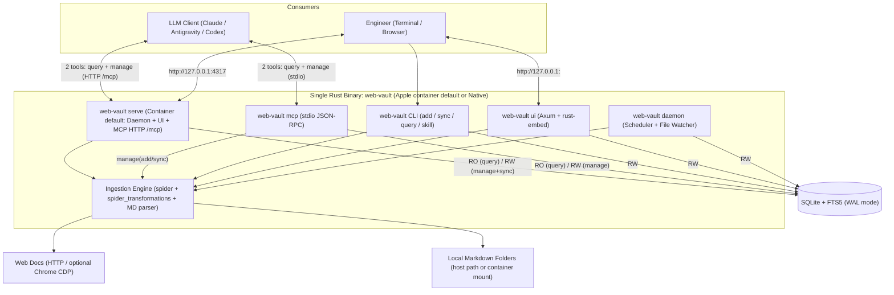

# Technical Specification: web-vault

> **Status:** Draft v1  
> **Stage:** `Idea -> PRD -> [TechSpec (SPEC.md)] -> AgentRules -> AtomicTasks -> Prototype -> LLMCode`  
> **Upstream:** [PRD.md](./PRD.md)

---

## 1. Architecture Overview

**web-vault** is built as a **single native Rust binary** (`web-vault`) backed by a local **SQLite (WAL mode) + FTS5** database.
- **Default deployment (Apple `container`):** Runs `web-vault serve` inside a minimal OCI Linux container managed by Apple's **`container`** CLI (`https://github.com/apple/container`, built from `Containerfile`/`Dockerfile`), combining the background scheduler/watcher, embedded Web UI (`/`), REST API (`/api/*`), and MCP Streamable HTTP endpoint (`/mcp`) in one low-resource process (~15–25 MB RAM).
- **Native installation (macOS/Linux):** Install the same binary locally; `cli`, `mcp` (`stdio`), `ui`, and `daemon` share `vault.db` directly in WAL mode so `mcp` and `cli` work even when the daemon is stopped.



### Data & Config Paths
Resolved via `WEB_VAULT_HOME` env var, `--data-dir` flag, or OS defaults (`directories` crate):
- **Container default:** `/data` (mounted persistent volume, `WEB_VAULT_HOME=/data`; optional host Markdown folders mounted read-only under `/sources/...`).
- **macOS (native):** `~/Library/Application Support/web-vault/` (or `~/.local/share/web-vault/` if XDG is set)
- **Linux (native):** `${XDG_DATA_HOME:-~/.local/share}/web-vault/`
- **Files inside data dir:**
  - `vault.db` (+ `vault.db-wal`, `vault.db-shm`) — primary SQLite database
- **`WEB_VAULT_ALLOW_PRIVATE_ORIGINS`:** `1` or `true` allows web Sources on Private origins (intranet docs, `localhost`); off by default.
  - `daemon.pid` — active daemon PID lockfile
  - `daemon.log` — rotating daemon log

---

## 2. Rust Crate Stack & Module Layout

### Core Dependencies
| Concern | Crate | Rationale |
|---|---|---|
| Async runtime | `tokio` (multi-thread, `rt-multi-thread`, `macros`, `signal`, `time`) | Required by `spider` and `axum` |
| CLI | `clap` (derive) | Type-safe subcommands, help, shell completions |
| Storage & FTS | `rusqlite` (`bundled`, `modern_sqlite`, `hooks`, `functions`) | Zero system SQLite dependency, FTS5 + authorizer + progress handler |
| Web crawling | `spider` + `spider_transformations` (MIT) | Async crawler, sitemap, politeness, readability + HTML-to-MD, optional `chrome` feature |
| Markdown parsing | `pulldown-cmark` | Fast AST heading splitter for `sections` |
| Hashing & Diffing | `sha2`, `similar` | Normalized SHA-256 content hashes + unified diffs |
| File watching | `notify` + `notify-debouncer-mini` | Cross-platform FS events for local Markdown folders |
| MCP server | `rmcp` (or lightweight custom JSON-RPC 2.0 over `tokio::io::stdin/stdout`) | Strict stdio transport; zero stdout pollution |
| Embedded Web UI | `axum`, `rust-embed`, `mime_guess`, `open` | Single-binary local web server, ~10 MB RAM |
| Logging & Errors | `tracing`, `tracing-subscriber`, `thiserror`, `anyhow` | Structured logs to `stderr` (never `stdout` in MCP mode) |

### Cargo Feature Flags
- `default = []` — pure Rust binary, no browser dependencies.
- `chrome = ["spider/chrome"]` — enables optional per-source headless Chrome/CDP rendering for JS-only SPAs.

### Source Layout
```text
src/
  main.rs            # CLI entrypoint & command dispatch
  config.rs          # Paths, env overrides, defaults
  db/
    mod.rs           # Connection pool/open helpers, WAL pragmas, migrations
    schema.sql       # Versioned SQLite DDL
    readonly.rs      # Read-only MCP query executor + authorizer + limits
  sources/
    mod.rs           # Source lifecycle: async-only `SourceLifecycle` (add, update, remove, sync,
                     # sync_all); registration, slugging, origin classification, limits.
                     # Every entry point (CLI, MCP, UI, daemon) goes through it.
  ingest/
    mod.rs           # Source/Page record types, row mappers, read views (list/show)
    web.rs           # spider + spider_transformations integration
    local.rs         # Local Markdown folder walker + frontmatter stripping
    normalize.rs     # Noise stripping, SHA-256 hashing, unified diff generation
    sections.rs      # pulldown-cmark heading splitter (H1-H3 breadcrumbs)
  mcp/
    mod.rs           # stdio JSON-RPC server + `query` and `manage` tool handlers
    prompt.rs        # Schema & SQL recipe description embedded in tool specs
  daemon/
    mod.rs           # Periodic refresh scheduler + notify folder watcher
    service.rs       # launchd plist & systemd --user unit generator
  ui/
    mod.rs           # Axum router, localhost binding, Origin guard
    api.rs           # JSON REST endpoints for the UI
    assets/          # Static HTML/CSS/JS embedded via rust-embed
  skill/
    mod.rs           # Skill path resolver + installer (CWD, --path, --global)
    SKILL.md         # Embedded static router skill (include_str!)
```

---

## 3. Database Schema & Read-Only Query Safety

### Pragmas (Applied on Every Connection)
- **Read-Write connections:** `PRAGMA journal_mode = WAL; PRAGMA synchronous = NORMAL; PRAGMA foreign_keys = ON; PRAGMA busy_timeout = 5000;`
- **MCP Read-Only connections:** opened with `OpenFlags::SQLITE_OPEN_READ_ONLY | SQLITE_OPEN_NO_MUTEX`, plus `PRAGMA query_only = ON; PRAGMA busy_timeout = 3000;`.

### SQLite DDL (`src/db/schema.sql`)
```sql
CREATE TABLE IF NOT EXISTS sources (
    id                    INTEGER PRIMARY KEY,
    name                  TEXT NOT NULL UNIQUE,           -- slug, e.g. 'hex-docs'
    kind                  TEXT NOT NULL CHECK (kind IN ('web', 'local')),
    origin                TEXT NOT NULL UNIQUE,           -- root URL or absolute dir path
    tags                  TEXT NOT NULL DEFAULT '[]',     -- JSON array of strings
    include_patterns      TEXT NOT NULL DEFAULT '[]',     -- JSON glob/prefix list
    exclude_patterns      TEXT NOT NULL DEFAULT '[]',     -- JSON glob/prefix list
    max_pages             INTEGER NOT NULL DEFAULT 500,
    max_depth             INTEGER NOT NULL DEFAULT 5,
    render_js             INTEGER NOT NULL DEFAULT 0,     -- 1 = use headless Chrome if enabled
    refresh_interval_secs INTEGER NOT NULL DEFAULT 86400, -- 0 = manual only
    status                TEXT NOT NULL DEFAULT 'idle'
                          CHECK (status IN ('idle', 'syncing', 'ok', 'error')),
    last_synced_at        TEXT,                           -- ISO-8601 UTC
    last_error            TEXT,
    created_at            TEXT NOT NULL DEFAULT (strftime('%Y-%m-%dT%H:%M:%SZ', 'now'))
);

CREATE TABLE IF NOT EXISTS pages (
    id               INTEGER PRIMARY KEY,
    source_id        INTEGER NOT NULL REFERENCES sources(id) ON DELETE CASCADE,
    uri              TEXT NOT NULL,                       -- canonical URL or relative file path
    title            TEXT NOT NULL DEFAULT '',
    content_md       TEXT NOT NULL,                       -- clean Markdown body
    content_hash     TEXT NOT NULL,                       -- SHA-256 of normalized content
    word_count       INTEGER NOT NULL DEFAULT 0,
    etag             TEXT,                                -- HTTP ETag for conditional GET
    last_modified    TEXT,                                -- HTTP Last-Modified header
    status           TEXT NOT NULL DEFAULT 'active'
                     CHECK (status IN ('active', 'stale', 'error')),
    http_status      INTEGER,
    error_message    TEXT,
    first_seen_at    TEXT NOT NULL DEFAULT (strftime('%Y-%m-%dT%H:%M:%SZ', 'now')),
    last_checked_at  TEXT NOT NULL DEFAULT (strftime('%Y-%m-%dT%H:%M:%SZ', 'now')),
    last_changed_at  TEXT NOT NULL DEFAULT (strftime('%Y-%m-%dT%H:%M:%SZ', 'now')),
    UNIQUE (source_id, uri)
);

CREATE TABLE IF NOT EXISTS sections (
    id            INTEGER PRIMARY KEY,
    page_id       INTEGER NOT NULL REFERENCES pages(id) ON DELETE CASCADE,
    source_id     INTEGER NOT NULL REFERENCES sources(id) ON DELETE CASCADE,
    ordinal       INTEGER NOT NULL,                       -- 0-based order in page
    heading       TEXT NOT NULL DEFAULT '',               -- section heading text
    heading_path  TEXT NOT NULL DEFAULT '',               -- breadcrumb: 'Ingestion > CDC'
    level         INTEGER NOT NULL DEFAULT 0,             -- 0=intro, 1=H1, 2=H2, 3=H3
    content_md    TEXT NOT NULL,
    word_count    INTEGER NOT NULL DEFAULT 0
);

-- Keeps the most recent diff per page (upserted on content change)
CREATE TABLE IF NOT EXISTS page_revisions (
    page_id        INTEGER PRIMARY KEY REFERENCES pages(id) ON DELETE CASCADE,
    previous_hash  TEXT NOT NULL,
    new_hash       TEXT NOT NULL,
    unified_diff   TEXT NOT NULL,                         -- capped at 64 KB
    changed_at     TEXT NOT NULL DEFAULT (strftime('%Y-%m-%dT%H:%M:%SZ', 'now'))
);

CREATE TABLE IF NOT EXISTS sync_runs (
    id              INTEGER PRIMARY KEY,
    source_id       INTEGER NOT NULL REFERENCES sources(id) ON DELETE CASCADE,
    started_at      TEXT NOT NULL,
    finished_at     TEXT,
    status          TEXT NOT NULL CHECK (status IN ('running', 'ok', 'error')),
    pages_added     INTEGER NOT NULL DEFAULT 0,
    pages_updated   INTEGER NOT NULL DEFAULT 0,
    pages_unchanged INTEGER NOT NULL DEFAULT 0,
    pages_stale     INTEGER NOT NULL DEFAULT 0,
    pages_failed    INTEGER NOT NULL DEFAULT 0,
    error_message   TEXT
);

-- Sync claims (ADR-0001): at most one Sync per Source across every process.
CREATE TABLE IF NOT EXISTS sync_claims (
    source_id      INTEGER PRIMARY KEY REFERENCES sources(id) ON DELETE CASCADE,
    pid            INTEGER NOT NULL,                      -- holder process id
    instance_token TEXT NOT NULL,                         -- random per holder process start
    claimed_at     TEXT NOT NULL                          -- ISO-8601 UTC
);

-- External-content FTS5 tables (porter + unicode61 tokenization)
CREATE VIRTUAL TABLE IF NOT EXISTS pages_fts USING fts5(
    title, content_md,
    content='pages', content_rowid='id',
    tokenize='porter unicode61'
);

CREATE VIRTUAL TABLE IF NOT EXISTS sections_fts USING fts5(
    heading_path, content_md,
    content='sections', content_rowid='id',
    tokenize='porter unicode61'
);

CREATE INDEX IF NOT EXISTS idx_pages_source_status ON pages(source_id, status);
CREATE INDEX IF NOT EXISTS idx_sections_page ON sections(page_id, ordinal);
CREATE INDEX IF NOT EXISTS idx_sections_source ON sections(source_id);
CREATE INDEX IF NOT EXISTS idx_sync_runs_source ON sync_runs(source_id, started_at DESC);
```

*FTS5 synchronization* is maintained via SQLite `AFTER INSERT`, `AFTER DELETE`, and `AFTER UPDATE` triggers on `pages` and `sections` so FTS indexes never drift from base tables.

### Convenience Views (for Concise LLM Queries)
- `v_sources`: joins `sources` with live counts of `active_pages`, `stale_pages`, `error_pages`, and `total_words`.
- `v_recent_changes`: joins `page_revisions`, `pages`, and `sources` ordered by `changed_at DESC`.

### Read-Only MCP Safety Guardrails (`src/db/readonly.rs`)
Every SQL statement executed through MCP passes **four layers of defense**:
1. **OS/SQLite read-only mode:** `SQLITE_OPEN_READ_ONLY` + `PRAGMA query_only = ON`.
2. **SQLite Authorizer callback:** Explicitly allows only `SQLITE_SELECT`, `SQLITE_READ`, `SQLITE_FUNCTION` (safe built-ins + FTS5 `bm25`/`snippet`/`highlight`), and denies `INSERT`, `UPDATE`, `DELETE`, `DROP`, `ALTER`, `ATTACH`, `DETACH`, `PRAGMA`, `VACUUM`, and `load_extension`.
3. **Single-statement enforcement:** Rejects multi-statement strings (`;` followed by non-whitespace tokens).
4. **Resource caps:**
   - **Timeout:** `progress_handler` aborts queries exceeding `5000 ms`.
   - **Row cap:** Default `limit = 50`, hard max `200` rows (enforced by wrapping or truncating iteration + setting `truncated: true`).
   - **Payload cap:** Hard cap of `100 KB` serialized JSON per tool response (with a clear truncation hint instructing the LLM to select `sections` or `snippet()` instead of full `pages.content_md`).

---

## 4. Ingestion, Normalization & Diff Pipeline

### 4.1 Web Ingestion (`spider` + `spider_transformations`)
1. **Discovery:** Initialize `spider::website::Website` on `source.origin` with:
   - Scope restricted to `origin` host + path prefix (unless overridden by `include_patterns`).
   - `respect_robots_txt(true)`, configurable `max_pages` and `max_depth`, polite concurrency cap (default 4 concurrent requests, 100 ms delay).
   - Automatic `sitemap.xml` discovery; if `llms.txt` exists at root, include its linked URLs in the seed queue.
   - If `source.render_js == 1` and binary is built with `--features chrome`, use `spider`'s Chrome headless mode; otherwise return a clear warning if `chrome` feature is absent.
2. **Extraction:** Transform raw HTML with `spider_transformations::transformation::content` (`ReturnFormat::Markdown`, `readability: true`, stripping `<nav>`, `<footer>`, `<script>`, `<style>`).
3. **Stale Detection:** Track the set of URIs seen during a full sync run. Any previously `active` page for that source **not** seen in the completed crawl is marked `status = 'stale'` (never silently deleted). Pages returning 4xx/5xx are marked `status = 'error'` with `http_status` and `error_message` while preserving their last good `content_md`.

### 4.2 Local Markdown Folder Ingestion
1. Recursively walk `source.origin` for `*.md` and `*.markdown` files (ignoring `.git`, `node_modules`, hidden dirs).
2. Store relative path (e.g., `chapters/ch05-ingestion.md`) as `uri`.
3. Extract `title` from YAML frontmatter `title:` if present, else first H1 heading, else filename stem.
4. Files removed from disk are marked `status = 'stale'` on sync (or deleted if `--prune` is explicitly passed).

### 4.3 Normalization & Meaningful Diffing (`src/ingest/normalize.rs`)
To eliminate false-positive diffs (such as volatile `created:` / `updated:` / `crawled_at:` frontmatter timestamps):
1. Strip YAML frontmatter volatile keys (`created`, `updated`, `date`, `crawled_at`, `fetched_at`, `last_modified`) before hashing.
2. Normalize line endings (`\r\n` -> `\n`), trim trailing whitespace per line, and collapse 3+ blank lines to 2.
3. Compute `content_hash = sha256(normalized_md)`.
4. Compare against existing `pages.content_hash`:
   - **Match:** Update `last_checked_at` only; increment `pages_unchanged`.
   - **Differ:** Generate a unified diff (`similar::TextDiff::from_lines`) capped at 64 KB, upsert `page_revisions`, update `pages.content_md`, `content_hash`, `last_changed_at`, and re-split `sections` inside a single SQLite transaction.

### 4.4 Heading-Based Section Splitting (`src/ingest/sections.rs`)
- Parse `content_md` with `pulldown-cmark`.
- Split on headings `H1`, `H2`, and `H3`, maintaining a heading stack to build `heading_path` (e.g., `Data Modeling > Kimball > SCD Types`).
- Content before the first heading becomes `ordinal = 0`, `level = 0`, `heading = '(Intro)'`.
- Sections exceeding ~2,000 words without subheadings are left intact in v1 (LLM can use `substr()` or `snippet()`).

---

## 5. MCP Server Specification (`web-vault mcp` & `/mcp`)

### Transports
- **Streamable HTTP (Container default):** Mounted at `POST/GET /mcp` on `web-vault serve` (default `http://127.0.0.1:4317/mcp` on the host). Lets any MCP client connect directly to the running container without spawning extra processes.
- **Stdio (Native & `container exec`):** `web-vault mcp` speaks newline-delimited JSON-RPC 2.0 on `stdin`/`stdout` (also usable via `container exec -i web-vault web-vault mcp`).
- **Logging rule:** In `stdio` mode, all logs MUST go to `stderr` or file—never `stdout`.

### Tool Surface (2 Minimal Composable Tools)

#### 1. `query` (Strictly Read-Only Data Retrieval)
- **Purpose:** Discover sources, search `pages_fts`/`sections_fts`, inspect diffs/staleness, and retrieve exact sections in one SQL call.
- **Connection:** Dedicated `SQLITE_OPEN_READ_ONLY` + authorizer connection (cannot mutate DB).
- **Input schema:**
```json
{
  "type": "object",
  "properties": {
    "sql": {
      "type": "string",
      "description": "Single read-only SQLite SELECT statement against sources, v_sources, pages, sections, pages_fts, sections_fts, page_revisions, or v_recent_changes."
    },
    "limit": {
      "type": "integer",
      "minimum": 1,
      "maximum": 200,
      "default": 50,
      "description": "Maximum rows to return (default 50, max 200)."
    }
  },
  "required": ["sql"]
}
```
- **Tool description:** Concisely embeds table/column names, FTS5 syntax (`sections_fts MATCH '...'`, `bm25(sections_fts)`, `snippet(...)`), and a 2-step pattern: (1) search `v_sources` or `sections_fts` for snippets/IDs, (2) fetch exact `sections.content_md` by `id`.
- **Success response:**
```json
{
  "columns": ["source", "uri", "heading_path", "snippet", "last_changed_at"],
  "rows": [ ... ],
  "row_count": 5,
  "truncated": false,
  "elapsed_ms": 4
}
```

#### 2. `manage` (Composable Vault Management)
- **Purpose:** Add, sync, update, or remove sources directly from the LLM without exposing one tool per operation.
- **Connection:** Uses the standard RW SQLite connection and the shared `ingest` module.
- **Input schema:**
```json
{
  "type": "object",
  "properties": {
    "action": {
      "type": "string",
      "enum": ["add", "sync", "update", "remove"],
      "description": "Vault management operation to perform."
    },
    "origin": {
      "type": "string",
      "description": "Required for 'add': http(s):// root URL or absolute local Markdown folder path."
    },
    "name": {
      "type": "string",
      "description": "Source slug. Optional for 'add' (auto-derived if omitted); required for 'update'/'remove'; optional for 'sync' (syncs all if omitted)."
    },
    "tags": {
      "type": "array",
      "items": { "type": "string" }
    },
    "refresh_interval_secs": {
      "type": "integer",
      "minimum": 0,
      "description": "0 = manual only."
    },
    "max_pages": { "type": "integer", "minimum": 1, "maximum": 5000 },
    "max_depth": { "type": "integer", "minimum": 1, "maximum": 20 },
    "include_patterns": { "type": "array", "items": { "type": "string" } },
    "exclude_patterns": { "type": "array", "items": { "type": "string" } },
    "render_js": { "type": "boolean" },
    "sync_now": {
      "type": "boolean",
      "default": true,
      "description": "For 'add': whether to run initial ingestion immediately (default true)."
    }
  },
  "required": ["action"]
}
```
- **Validation & Safety Guardrails for `manage`:**
  - `origin` URLs must use `http://` or `https://` and reject Private origins (loopback, RFC1918, link-local such as `169.254.169.254`, CGNAT, multicast, `localhost`/`*.local`) unless `WEB_VAULT_ALLOW_PRIVATE_ORIGINS=1`. The same rule (`src/sources/origin.rs`) applies to every entry point: CLI `add`, UI `POST /api/sources`, MCP `manage add`, and every Sync, including the scheduler.
  - Local `origin` paths must resolve to an existing directory (`canonicalize`) and only ingest `*.md` / `*.markdown` files.
  - `remove` returns the deleted source name and page count; `add`/`sync` returns structured sync summary (`pages_added`, `pages_updated`, `pages_unchanged`, `pages_stale`, `pages_failed`).
- **Error response (both tools):** `isError: true` with an actionable error message (e.g., `"Write operations are disabled on MCP query tool"`, `"no such column: ..."`, or `"origin must be an http(s) URL or existing directory"`), enabling immediate LLM self-correction.

---

## 6. CLI Specification

```text
web-vault
  add <url-or-path> [--name <slug>] [--tags <a,b>] [--interval <duration>]
                    [--max-pages <n>] [--max-depth <n>] [--include <pat>...]
                    [--exclude <pat>...] [--render-js] [--no-sync]
  list [--json]
  show <name>                     # source details, sync history, stale/error pages
  sync [<name>] [--all] [--prune] # manual sync for one or all sources
  rm <name> [--yes]               # remove source and cascade stored pages
                                  # add/sync refuse Private origins (loopback, RFC1918,
                                  # link-local, localhost) unless WEB_VAULT_ALLOW_PRIVATE_ORIGINS=1
  query "<sql>" [--limit <n>] [--format table|json|csv]
  serve [--bind 0.0.0.0:4317]     # all-in-one server: daemon + Web UI + MCP HTTP (/mcp) (Container default)
  mcp                             # start stdio MCP server (native / container exec)
  ui [--port <port>] [--no-open]  # launch embedded local Web UI (native)
  daemon
    start [--foreground]
    stop
    status
    install                       # write & load launchd (macOS) / systemd --user (Linux)
    uninstall
  skill
    install [--path <dir>] [--global] [--target <agents|claude|copilot|opencode|all>] [--force]
```

### `skill install` Path Resolution
The embedded static router `SKILL.md` (`src/skill/SKILL.md`) documents the SQLite schema, FTS5 query recipes, and grounding rules.
1. **Default (no flags):** Installs into `./.agents/skills/web-vault/SKILL.md` in the current working directory.
2. **`--path <dir>`:** Installs into `<dir>/web-vault/SKILL.md` (creating parent directories if needed).
3. **`--global`:**
   - Default `--target all` (or `agents`): writes the canonical copy to `~/.agents/skills/web-vault/SKILL.md` and creates a symlink at `~/.claude/skills/web-vault -> ~/.agents/skills/web-vault` (if `~/.claude` exists or `--target claude` is requested).
   - Additional `--target` values (`copilot` -> `~/.copilot/skills/web-vault`, `opencode` -> `~/.config/opencode/skills/web-vault`) symlink to the same canonical `~/.agents/skills/web-vault` directory.
4. **Safety:** Refuses to overwrite an existing `SKILL.md` unless `--force` is passed.

---

## 7. Embedded Local Web UI (`web-vault ui`)

### Server & Security
- Built with `axum`, serving static assets embedded at compile time via `rust-embed` (zero external CDN requests, works 100% offline).
- Binds strictly to `127.0.0.1:<port>` (defaults to an ephemeral free port or `4317`, auto-opening `http://127.0.0.1:<port>` unless `--no-open`).
- Mutating endpoints (`POST`, `DELETE`) verify `Origin`/`Host` is `127.0.0.1`/`localhost` to prevent cross-site local requests.

### REST API Endpoints
| Method & Path | Purpose |
|---|---|
| `GET /api/sources` | List all sources with page/stale/error counts (`v_sources`) |
| `POST /api/sources` | Add a web URL or local Markdown folder |
| `DELETE /api/sources/:id` | Delete a source |
| `POST /api/sources/:id/sync` | Trigger async background sync for a source |
| `GET /api/sources/:id/pages` | List/filter pages (`?status=active|stale|error&q=...`) |
| `GET /api/pages/:id` | Full page Markdown + sections + metadata |
| `GET /api/pages/:id/diff` | Latest unified diff from `page_revisions` |
| `POST /api/query` | Run read-only SQL query via `db::readonly` |

### UI Views (Lightweight Vanilla JS / Minimal CSS)
1. **Sources:** Table of web + local sources, status badges, last-synced time, quick Add modal, Sync/Delete actions.
2. **Knowledge Browser:** Filter by source or FTS search, inspect rendered/raw Markdown and heading sections.
3. **Changes & Health:** Recent diffs (`v_recent_changes`) with colored unified diff viewer + list of `stale`/`error` pages.
4. **SQL Explorer:** Interactive read-only query box using the exact same `query` engine as the MCP server.

---

## 8. Deployment & Background Lifecycle

### 8.1 Default Deployment: Apple `container` (`Dockerfile`)
Uses Apple's native macOS OCI runtime (**`container`**, `https://github.com/apple/container`)—no Docker Desktop required.
- **Multi-stage `Dockerfile` (OCI-standard):**
  - Builder stage: `rust:1-slim` compiling `--release` binary (`linux/arm64` native on Apple Silicon, `linux/amd64` portable).
  - Runtime stage: `debian:bookworm-slim` (or `gcr.io/distroless/cc-debian12`) running as non-root user `webvault`, final image ~25–35 MB (optional `--build-arg FEATURES=chrome` variant installs headless Chromium).
- **Container entrypoint:** `web-vault serve --bind 0.0.0.0:4317` (runs the background scheduler, local folder watcher, embedded Web UI on `/`, REST API on `/api/*`, and MCP Streamable HTTP on `/mcp`).
- **Standard `container` CLI workflow:**
  ```bash
  # One-time setup & build
  container system start
  container volume create web-vault-data
  container build -t web-vault:latest .

  # Run detached with loopback port publish, persistent volume, and optional local Markdown mount
  container run -d --name web-vault \
    -p 127.0.0.1:4317:4317 \
    -e WEB_VAULT_HOME=/data \
    -v web-vault-data:/data \
    -v /Users/maxime/Dev/books/markdown:/sources/books:ro \
    web-vault:latest
  ```
- **CLI & operations with `container`:**
  - Run CLI commands inside the container: `container exec web-vault web-vault <cmd>` (e.g., `add`, `sync`, `query`), or manage via the Web UI at `http://127.0.0.1:4317`.
  - Inspect status/logs: `container ls`, `container logs web-vault`, `container stop web-vault`.
  - A small `Makefile` (or `justfile`) wraps `container build`, `run`, `stop`, `logs`, and `exec` for one-command ergonomics.

### 8.2 Optional Native Install (macOS / Linux)
- **Install:** `cargo install --path .` (or prebuilt GitHub Release binary) puts `web-vault` on `$PATH`.
- **PID & single-instance lock:** Acquires an advisory file lock on `daemon.pid` so only one daemon runs per `WEB_VAULT_HOME`.
- **OS service integration (`web-vault daemon install`):**
  - **macOS:** Generates `~/Library/LaunchAgents/com.webvault.daemon.plist` (`KeepAlive`, `RunAtLoad`) and loads via `launchctl`.
  - **Linux:** Generates `~/.config/systemd/user/web-vault.service` and enables via `systemctl --user`.

### 8.3 Shared Scheduler & Watcher Behavior (Container & Native)
- **Web scheduler loop:** Ticks every 60 seconds; selects `web` sources where `refresh_interval_secs > 0` and `last_synced_at + refresh_interval_secs <= now`; runs up to 2 source syncs concurrently with small random jitter (0–30s).
- **Local folder watcher:** Registers a `notify` debounced watcher (2-second debounce) on each `local` source directory; triggers incremental re-indexing of changed `.md` files only.
- **Graceful shutdown:** Handles `SIGINT`/`SIGTERM`, finishes in-flight DB transactions cleanly, removes `daemon.pid`.

---

## 9. Testing & Verification Strategy

| Layer | What is Tested |
|---|---|
| **Unit tests** | Frontmatter/noise stripping & SHA-256 stability; `pulldown-cmark` H1–H3 section splitting & breadcrumbs; unified diff generation; `skill install` path resolution & symlinks. |
| **SQLite safety tests** | Verify MCP `query` rejects `INSERT`, `UPDATE`, `DELETE`, `DROP`, `ATTACH`, `PRAGMA`, multi-statements, and enforces timeout + row/byte caps. |
| **Integration tests** | Local `wiremock`/Axum fixture site crawled via `spider` -> stored -> modified -> re-crawled (verifying `pages_updated`, `page_revisions`, and `stale` marking on removed URL); temp Markdown folder sync; end-to-end `web-vault mcp` `stdio` JSON-RPC round-trip. |
| **Resource budget check** | Verify idle `web-vault daemon` RSS stays under ~25 MB on a 1,000-page vault. |
